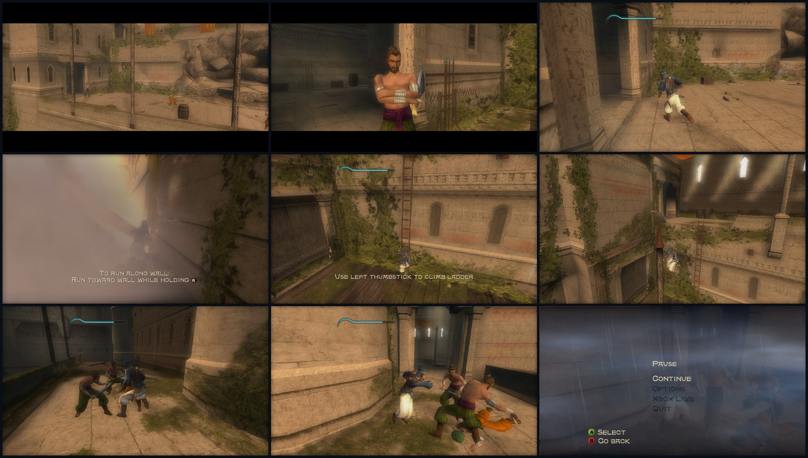
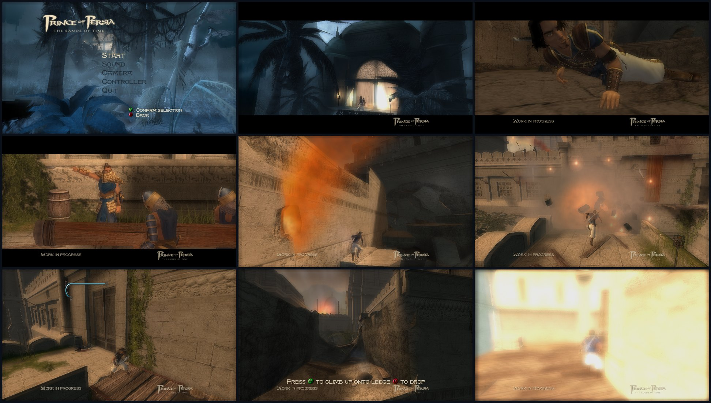

<p align="center">
  
</p>

<p align="center">
  <a href="https://www.buymeacoffee.com/fulger" target="_blank"></a>
</p>

# reSOT

**Prince of Persia: The Sands of Time, recompiled from Xbox to native Windows and Android.**

**Current version: v0.5.0** ([release notes](docs/releases/v0.5.0.md)).

reSOT is a static recompilation and port of the original Xbox retail game and
the E3 2003 demo. The game's own x86 code is lifted to C and compiled as a
native program that runs against reSOT's replacement for the Xbox hardware and
services. **Both games have been tested from start to finish and can be
completed**, with gameplay, menus, movies, audio, saves and controllers working.

Windows has separate native executables for the demo and the retail game.
Android has one arm64 app for both, with Vulkan rendering, an ISO installer and
touch controls.

**You need your own game files.** reSOT does not include the game, extracted
assets or Xbox executables. The generated C is published with the project; it
remains derived from the original game and is not covered by reSOT's MIT licence.

## Playability

| Target | Supported Xbox executable | State |
| --- | --- | --- |
| `xbox-demo` | E3 2003 demo, built 2003-07-18 | 🟢 Tested and completable on Windows and Android: every level of the demo, menus, movies, audio and controls, plus the restored Load Map menu. |
| `xbox-retail` | NTSC retail, title `0x5553001D`, built 2003-10-20 | 🟢 Tested and completable on Windows and Android: the whole game, with corrected timing, audio, rendering and HUD; English, French and Spanish. |
| `xbox-retail` with EU disc assets | PAL EU data, running the recompiled NTSC executable | 🟡 Windows: startup, movies, menu and an existing cave-area save loaded in a 40-second check. Italian menu and German-language startup checked on Windows in v0.5.0; full EU game not checked. Android: EU installation and checked runtime substitution implemented; device run pending. |

Performance depends on the device, renderer, scene and graphics settings. In a
heavy retail scene (about 1,600 draws a frame) on Windows, Vulkan, RTX 3060 at
225% internal resolution, v0.4.4 runs at about 143 fps (about 64 fps before the
v0.4.4 work); an empty view at about 700 fps.



*Windows retail, first areas, 16:9 Hor+.*



*Windows demo, 16:9 Hor+.*

## Features and status

🟢 Tested. 🟡 Implemented, with checks or known limits remaining. ⚪ Not
validated or not implemented. Green describes the listed feature in the tested
scope; it does not certify every device or exact console accuracy. Commands,
observations and limits are in [VALIDATION.md](docs/VALIDATION.md).

### Game

| Feature | Xbox demo | Xbox retail |
| --- | --- | --- |
| Static recompilation and native builds | 🟢 Windows and Android | 🟢 Windows and Android |
| Boot, title screen and main menu | 🟢 | 🟢 |
| Full game, start to finish | 🟢 Completed | 🟢 Completed |
| Bink movies and skipping | 🟢 The original E3 closing clip has no audio track | 🟢 |
| Game audio, music and effects | 🟢 | 🟢 |
| Save/load and memory units | 🟢 | 🟢 |
| Keyboard, mouse and physical controllers | 🟢 | 🟢 |
| Native menus, pause and reSOT Options | 🟢 Load Map and reSOT Options in main and pause menus; "E3 Demo" title and E3 logo as in the E3 build; "Quit to Demos Menu" hidden | 🟢 reSOT Options in main and pause menus; Xbox Live entries hidden |
| Game language (English, French, Spanish, Deutsch, Italiano) | ⚪ English only: the demo's languages are not checked | 🟡 Five permanent choices in reSOT Options, applied at the next start; missing German/Italian banks fall back to English without clearing the preference. EU language checks are recorded in VALIDATION.md. |
| Special Load Map (reSOT Options) | 🟡 All 20 maps of the BF; 4 of 12 faulted in scripted direct requests, the menu's own path not yet checked on those | 🟡 30 area maps loaded as a saved game; 1401 Corridor Start and 8101 Tower Base replaced by maps with a checkpoint; 3101 Tower starts with a fall (Retry works) |
| Built-in cheats switch (reSOT Options and F7) | 🟢 OVA 8 `mb_CheatsEnabled`, no BF rebuild | 🟢 Same for OVA 22 |
| F7 Game behavior: Tutorials, Dagger of time, Cheats | 🟡 Dagger effect not checked; Tutorials not available | 🟡 Tutorials saved in the universe; Cheats On/Off |
| Mid-game freeze with audio still playing (BlockOnFence NOTIFY) | 🟢 Handled | 🟢 Handled; the wait is also released once the renderer has caught up |

### Graphics

| Feature | Xbox demo | Xbox retail |
| --- | --- | --- |
| Native Direct3D 11 renderer | 🟢 Windows default | 🟢 Windows default |
| Native Vulkan renderer | 🟢 Windows and Android | 🟢 Windows and Android |
| Native Direct3D 12 renderer | 🟡 Optional Windows backend | 🟡 Optional Windows backend; broader gameplay checks pending |
| Direct renderer path (on by default, `RESOT_DIRECT_DRAW=0` turns it off) | 🟡 Draws and state reach the renderer as typed tokens; tested on D3D12; fences, swap and pushbuffer replay still in the ring | 🟢 Tested on D3D12 and Vulkan; recorded pushbuffers as direct draws; game and renderer in parallel, at most two frames apart |
| Game and renderer in parallel (asynchronous KickOff) | ⚪ Kept synchronous: with more depth the first level drew almost black | 🟢 32 submissions and at most two frames ahead (`RESOT_KICK_AHEAD`, `RESOT_FLIP_AHEAD`); a session longer than about 33,000 frames not yet checked for the black-level defect |
| Widescreen Hor+ and HUD layout | 🟢 Artwork edges remain limited | 🟢 Ultrawide sand-tank alignment; some dialog layout limits remain |
| HD menu font | 🟡 Shared 4x glyph replacement on all renderers; tested on Windows | 🟡 Same replacement; broader visual check pending |
| HD menu logo | 🟡 Built on all renderers, not yet seen in game | 🟢 |
| Graphics presets (Reduced, Standard, Full) | 🟡 Policy tests pass; gameplay checks pending | 🟡 Same shared policy |
| Shadows, stencil and effects | 🟢 Character shadows; remaining stencil/effect coverage open | 🟢 Same; broader scene coverage open |
| Light halos | 🟢 | 🟢 Depth-tested halos; visibility ratio kept within 0..1 at raised resolutions (green or white flashes fixed in v0.4.4, not yet seen) |
| Retail Vulkan black flashes / Farah Room main gate | Not reported for demo | 🟡 Black flashes fixed; main gate fixed on D3D11 only; a Vulkan driver fault there is open |

### Platforms

| Feature | Xbox demo | Xbox retail |
| --- | --- | --- |
| Windows play | 🟢 High frame rates | 🟢 High frame rates |
| Android play with native Vulkan | 🟢 | 🟢 |
| Android gameplay touch controls | 🟢 Custom layout, vibration | 🟢 Same shared controls |
| Mouse/touch selection of menu rows | 🟡 Text and literal-text choices; broader interaction checks pending | 🟢 Yes/No choices and save-carousel arrows |
| Windows light-halo mouse cursor | 🟡 Built; embedded cursor loads, visual check pending | 🟢 User confirmed the new look in the Windows session |
| Automatic Android overlay hiding | 🟡 Policy tests pass; device checks pending | 🟡 Same |
| Adreno 640 / MediaTek / Samsung | 🟢 Tested after the SDL mip correction | 🟢 Poco colored-pixel corruption fixed |
| Mali GPUs (Mali-G57, Mali-G710, Mali-G78) | 🟡 Crash on Start Game traced to SPIR-V extensions older drivers reject; shaders rebuilt without them; not yet run on a Mali device | 🟡 Same |
| Launcher, game-folder selection and ISO installation | 🟢 Both hosts | 🟢 Both hosts; separate retail detection |
| FPS panel, diagnostics, input rebinding, Android log sharing | 🟢 | 🟢 |

Known issue: in the retail Magic Fountain teleport the fade to black does not
appear and the camera stays at the entrance on the bridge until the view is
changed.

## Playing on Windows and Android

| Platform | Renderer and package | Instructions |
| --- | --- | --- |
| Windows 10/11 x64 | Separate demo/retail EXEs. Direct3D 11 by default; native Vulkan and Direct3D 12 selectable, with restart. | [Windows guide](port/windows/README.md) |
| Android 10+ arm64 | One APK, `com.fulger.resot`, for both targets. Native Vulkan through SDL GPU. | [Android guide](port/android/README.md) |

**Windows:** open the target's EXE to use the launcher, then select your game
folder or install your ISO. Demo and retail use separate game folders. The
locally built EXE embeds its checked Xbox image; a separate `default.xbe` is not
needed beside it. Space or controller A skips videos. F5 toggles the
FPS/current-world panel, F6 the diagnostics panel, F7 the host options, F8 the
debug views and F11 fullscreen.

The Windows launcher also recognises the PAL EU disc. Its `VIDEO/30fps`
movies (or `25fps` when needed) are found automatically, without moving or
changing disc files. Other recognised Sands of Time disc revisions can be
tried with a compatibility notice; selected/remembered folders take precedence
over automatic detection. This reuses the built-in NTSC runtime, not the other
disc's executable. Missing or incompatible data can still fail to load.

**Android:** install the APK and use the launcher to install your own ISO. The
app keeps demo and retail under `Android/data/com.fulger.resot/files/xbox-demo`
and `xbox-retail` and checks the disc's `default.xbe`. Retail EU data uses the checked NTSC
image embedded in the locally built APK, as on Windows; no manual XBE
replacement is required. Use the touch
controls or a physical controller. Compatible Adreno devices can also select a
user-supplied custom Vulkan driver from the launcher; none is bundled.

Graphics, controls and the game language are also in the native reSOT Options
menu. Both hosts save preferences in `resot-options.ini`. Defaults: unlimited
FPS, VSync and logs off, Graphics preset Standard, 200% look sensitivity,
English. Windows defaults to D3D11 at 720p (150%); Android to Vulkan at 480p
(100%). Existing preferences survive upgrades.

## Build from your own Xbox files

Copy the contents of your discs into these ignored folders:

```text
Assets/
  xbox-demo/     default.xbe  prince.bf  video/  sound/
  xbox-retail/   default.xbe  prince.bf  shaders.bin  VIDEO/  SOUND/  MEDIA/  POP1/  POP2/
```

Only the checked executable revisions below are supported. Demo and retail have
different addresses, hooks and seed lists; the build verifies SHA-256.

```text
xbox-demo    79C1A47828630AB0D4E5DD19B1FD036FFA58EA2C0FE729B0D3456DAC3E79D4F5
xbox-retail  753C58B191279BF4D1A8B28A936DF36AA222ED566487AB1FBDFCD090E91EE379
```

Windows builds use Visual Studio's C++ tools, CMake and Python with Capstone.
Android adds the SDK, NDK and Gradle. See the platform guides for pinned
versions and dependency setup.

```powershell
.\tools\recomp.ps1 -Target xbox-demo
.\tools\recomp.ps1 -Target xbox-retail
.\tools\run.ps1 -Target xbox-demo
.\tools\run.ps1 -Target xbox-retail

# Rebuild existing lifted sources after host/runtime changes:
python tools/check-hlsl.py
.\tools\recomp.ps1 -Target xbox-demo -BuildOnly
.\tools\recomp.ps1 -Target xbox-retail -BuildOnly

# One Android APK containing both targets:
.\tools\build-android.ps1
```

Windows outputs are `bin/sot-xbox-demo.exe` and `bin/sot-xbox-retail.exe`;
Android outputs `bin/reSOT-android.apk`. Outputs and game data stay local and
ignored. Use `tools/shortcut.ps1` for a Windows desktop shortcut.

## How it works

```text
Your default.xbe -> analyse and lift x86 to C -> native compiler
                                                   |
                 original game + linked Xbox libraries
                                                   |
                    reSOT platform and Xbox runtime
                  /                                \
     Windows: D3D11 / Vulkan / D3D12        Android: Vulkan
```

The original BigFile loader, Jade engine, compiled AI, Bink decoder and Xbox
Direct3D code remain in the lifted program. reSOT replaces kernel services,
memory, threads, input, audio and video. Rendering goes through the direct
renderer path: the game's Direct3D routines hand the host renderer typed draws
and state ([DIRECT-RENDERER.md](docs/DIRECT-RENDERER.md)); what is not yet
translated still goes through the NV2A pushbuffer interpreter. Both targets
share a runtime, with independently verified target-specific behaviour selected
at build time.

The generated C lives in `source/<target>/gen/`, sorted by kind of code and
published alongside the executable descriptions, host layers and tools. It is
regenerated from the user's own checked XBE and is never edited by hand.

## Source layout and documentation

| Path | Contents |
| --- | --- |
| `source/xbox-demo/`, `source/xbox-retail/` | Target facts, seed lists, entry hooks and generated C |
| `port/windows/` | Windows host, launcher, options, diagnostics and resources |
| `port/android/` | Android native host, Gradle app, launcher, installer and touch controls |
| `port/game/` | Shared manual overrides, HD font and logo data, mouse/touch menu bridge |
| `port/render/` | Native shader compiler and cache support |
| `port/third_party/xboxrecomp/` | Vendored recompiler and shared Xbox runtime; local changes marked `RE-SoT` |
| `port/third_party/extract-xiso/` | ISO extraction used by the launchers |
| `tools/` | Build, run, setup, analysis and regression tools |
| `docs/` | Validation, technical studies, release notes, licensing and screenshots |
| `Assets/`, `research/`, `bin/`, `build*/`, `logs/` | Private game files, analysis or local outputs; ignored |

- [Validation and observed results](docs/VALIDATION.md)
- [Direct renderer path](docs/DIRECT-RENDERER.md)
- [Recompilation pipeline and target evidence](docs/RECOMP.md)
- [Windows/Android parity](docs/PLATFORM-PARITY.md)
- [Vulkan performance and rendering studies](docs/VULKAN-PERFORMANCE.md)
- [Post-processing and remaining effect work](docs/POST-PROCESSING.md)
- [Regression tests](tools/tests/README.md)
- [Licensing and provenance](docs/LICENSING.md)

## Release history

| Version | Highlights | Notes |
| --- | --- | --- |
| 0.5.0 | EU retail disc installation on Windows and Android; five permanent language choices including Deutsch and Italiano; missing-language fallback; Windows light-halo cursor. Android versionCode 15. | [v0.5.0](docs/releases/v0.5.0.md) |
| 0.4.4 | Direct renderer on by default on every renderer; retail recorded pushbuffers as direct draws; game and renderer in parallel (heavy retail scene about 64 to 143 fps, Vulkan); light halo fix; game language in reSOT Options only. Android versionCode 14. | [v0.4.4](docs/releases/v0.4.4.md) |
| 0.4.3 | English, French and Spanish (retail); translated launchers; one shader per render state on D3D11 and D3D12; less stutter; F8 debug views; new Android icon background. | [v0.4.3](docs/releases/v0.4.3.md) |
| 0.4.2 | HD main menu logos; retail name keyboard with mouse and touch; sand tank HUD; Vulkan black flashes; demo 6201 PrisonA entry. | [v0.4.2](docs/releases/v0.4.2.md) |
| 0.4.1 | Retail flicker, black scenes and GPU-thread crashes; Special Load Map crashes; loading-screen hang; Android logs tip. | [v0.4.1](docs/releases/v0.4.1.md) |
| 0.4.0 | Special Load Map; built-in cheats switch; F7 Game behavior; HD menu font. | [v0.4.0](docs/releases/v0.4.0.md) |
| 0.3.4 | Rejected pipelines no longer close the game (Mali); stuck D3D wait released; definitive logo. | [v0.3.4](docs/releases/v0.3.4.md) |
| 0.3.3 | Game and GPU executor in parallel on retail; mid-game freeze fix; less audio crackle. | [v0.3.3](docs/releases/v0.3.3.md) |
| 0.3.2 | Android GPU compatibility; character shadows; graphics presets; Android log sharing; update check. | [v0.3.2](docs/releases/v0.3.2.md) |
| 0.3.1 | HUD and menu touch fixes; bridge and light corrections; launcher refresh. | [v0.3.1](docs/releases/v0.3.1.md) |
| 0.3.0 | Retail music; persistent demo menu additions; mouse and touch menus; automatic Android overlay; Vulkan caches. | [v0.3.0](docs/releases/v0.3.0.md) |

## Contributing and licence

Read [AGENTS.md](AGENTS.md) first. Keep demo and retail evidence separate; do
not commit game files, Xbox images, extracted assets or local executables.
Publish generated C with the project, regenerate it through the tools, and
record tested behaviour and remaining limits in the validation log.

reSOT's own files are MIT. The vendored runtime includes MIT and
LGPL-2.1-or-later components; extract-xiso carries its own BSD-style licence.
The game, its assets and the generated game/XDK code belong to their owners and
are not covered by reSOT's MIT licence. Locally built executables embed the
user's checked Xbox image and are for the owner of the original game. See
[LICENSE](LICENSE) and [LICENSING.md](docs/LICENSING.md).

*Prince of Persia* is a trademark of Ubisoft. This project is not affiliated
with or endorsed by Ubisoft or Microsoft.
