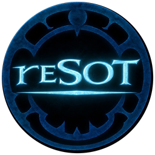
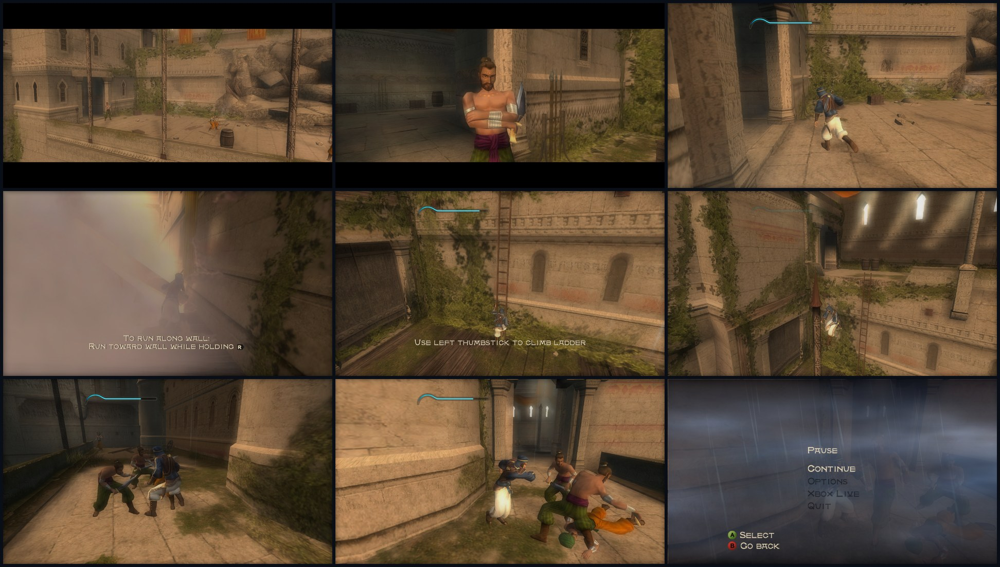
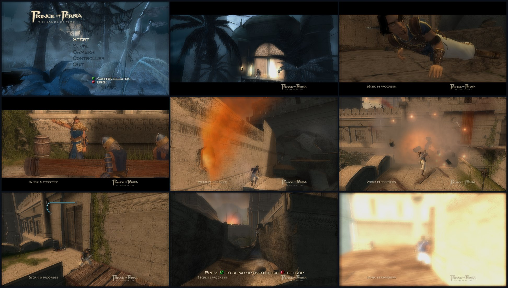

<p align="center">
  
</p>

<p align="center">
  <a href="https://www.buymeacoffee.com/fulger" target="_blank"></a>
</p>

# reSOT

**Prince of Persia: The Sands of Time, recompiled from Xbox to native Windows and Android.**

**Current version: v0.3.1.** reSOT is an advanced, playable recompilation and
port of the original Xbox retail game and E3 2003 demo. Both games now run
well on Windows and Android in the configurations tested by the user, with
working gameplay, menus, movies, audio and controller support. The project
has progressed beyond initial boot and rendering bring-up into gameplay,
performance improvements and platform polish.

Windows has separate native executables for demo and retail. Android has one
native arm64 app for both, with Vulkan rendering, a game installer and touch
controls. This is static recompilation: the original game's code runs as
native code against reSOT's replacement for the Xbox hardware and services.

**You need your own game files.** reSOT does not include the game, extracted
assets or Xbox executables. The generated C is published with the project;
it remains derived from the original game and is not covered by reSOT's MIT licence.

## Playable targets

| Target | Supported Xbox executable | Current state |
| --- | --- | --- |
| `xbox-demo` | E3 2003 demo, built 2003-07-18 | 🟢 Playable on Windows and Android. Menus, movies, audio, controls and level gameplay are running. Windows play has reached the third level; the demo also has its restored Load Map menu. |
| `xbox-retail` | NTSC retail, title `0x5553001D`, built 2003-10-20 | 🟢 Playable on Windows and Android. Substantial gameplay has been reported, with corrected game timing, audio, rendering and HUD alignment. The v0.3.0 Windows menu-music restoration is confirmed by the user. |

The user reports that the game now runs well on both platforms. Performance
still depends on the device, renderer, scene and graphics settings. This is
an advanced playable port, with full-game completion, remaining graphical
edge cases and some recent platform features still under validation.



*Windows retail captures from the first areas, 2026-10-17, using scripted
controller input at 16:9 Hor+. The F5 panel was covered with black in the two
letterboxed cutscene frames. These are gameplay examples, not a full-game test.*



*Windows demo captures from a scripted 185-second run, 2026-10-14, at 16:9 Hor+.*

## What's included in v0.3.1

- **HUD and menu touch fixes.** The upgraded retail health-bar outline stays
  aligned with its fill. Native literal-text choices, including Yes/No,
  are clickable; the retail save carousel's arrows send left/right input.
- **Bridge and light corrections.** Correct homogeneous depth reconstruction
  resolves the demo bridge defect confirmed on Android. The traced LowerBath
  halo variant now receives the same correction, also confirmed by the user.
- **Launcher refresh.** Both launchers show the app version in the upper left,
  with reSOT and Prince of Persia in Atlantis and The Sands of Time in the
  normal badge font.

The release also retains the v0.3.0 features below.

- **Retail music restoration.** Restores the original synchronous streaming
  completion path. Music is audible again in the Windows retail main menu,
  confirmed by the user. Gameplay music and Android listening after this
  particular fix still need separate confirmation.
- **Persistent demo menu additions.** Load Map and reSOT Options are rebuilt
  whenever the demo recreates its main menu, fixing their disappearance
  after a menu rebuild or return from gameplay.
- **Cleaner retail menus.** Xbox Live is hidden in both the main menu and
  the pause Options page. Xbox Live itself is not implemented.
- **Mouse and touch menus.** Point at native menu rows and left-click to
  select; right-click goes back. On Android, tap a row to select and swipe
  right or use Android Back to go back. Keyboard and controller remain available.
- **Automatic Android control visibility.** The touch pad hides in menus,
  Bink movies and camera scenes with cinematic bars, then restores the
  player's visibility preference in gameplay. The FPS button becomes invisible
  when the pad is hidden or its panel is open; its touch area stays active.
  The overlay toggle stays visible with the pad and fades to invisible only
  when the pad is hidden, keeping its touch area active and allowing
  the full pad to be reopened in menus and cutscenes. With the pad hidden,
  styled Back and Confirm buttons appear at the bottom corners. Tapping a
  Bink movie or pressing Confirm skips it.
- **Vulkan performance work.** Dedicated shader translation and caching,
  material descriptor caching, exact input-geometry reuse, batched command
  payloads and texture-upload improvements reduce repeated work on both hosts.
  The user confirms a substantial improvement with the geometry-cache build.
- **Rendering and HUD corrections.** Includes the retail fountain-return
  correction and ultrawide sand-tank alignment, plus newer RGB565 alpha and
  shadow-projection corrections. The latter still need visual confirmation.
- **Android audio and power handling.** Bounds stale audio queues after
  stalls, permits bounded audio catch-up, and adjusts display refresh and
  temporary thermal frame budgets without overwriting the user's settings.
- **Updated controls and diagnostics.** Refined Android touch pictograms and
  HUD clearance, repaired log-source selection, and retained the shared
  graphics, input and diagnostic options.

Both Windows targets and the Android release APK build as **0.3.1**;
Android uses **versionCode 6**. Shader compilation, pointer, touch and GPU
regressions passed in the recorded release checks. The user confirms the
extended health-bar alignment, popup/save-carousel touch changes and launcher
presentation on the Android test phone. See [VALIDATION.md](docs/VALIDATION.md)
for commands, observations and remaining device coverage.

## Features and current status

🟢 Working in recorded runs or confirmed by the user. 🟡 Implemented with
remaining checks or known limitations. ⚪ Not validated or not implemented.
Green describes the listed feature and tested scope; it does not certify
every level, device or exact console accuracy.

| Feature | Xbox demo | Xbox retail |
| --- | --- | --- |
| Static recompilation and native builds | 🟢 Windows and Android | 🟢 Windows and Android |
| Boot, title screen and main menu | 🟢 | 🟢 |
| In-level gameplay and rendering | 🟢 Played through multiple demo levels; remaining visual edge cases tracked | 🟢 Substantial gameplay reported; remaining scene-specific issues tracked |
| Windows play | 🟢 Keyboard/mouse or controller; high frame rates reported | 🟢 Corrected timing; high frame rates reported |
| Android play with native Vulkan | 🟢 Runs well in user-tested configurations | 🟢 Runs well in user-tested configurations; caching improvements confirmed |
| Bink movies and video skipping | 🟢 Audio/video confirmed | 🟢 Audio/video confirmed |
| Game audio and effects | 🟢 Audio and earlier stutter/crash fixes confirmed | 🟢 Audio and earlier movie-return fix confirmed; Windows menu music restored in v0.3.0 |
| Keyboard and physical controllers | 🟢 | 🟢 |
| Android gameplay touch controls | 🟢 Custom layout, vibration and approved visual design | 🟢 Same shared controls |
| Native menu navigation and pause | 🟢 Includes Load Map and reSOT Options | 🟢 Includes reSOT Options; Xbox Live entries hidden |
| Mouse/touch selection of menu rows | 🟡 Text and literal-text choices covered; synthetic tests pass; broader interaction checks pending | 🟢 Yes/No choices and save-carousel arrows confirmed on the Android test phone; synthetic tests pass |
| Automatic Android overlay hiding | 🟡 Toggle stays visible with pad; hidden toggle/FPS remain touchable. Policy tests pass; device checks pending | 🟡 Same shared implementation and validation limit |
| Native Vulkan renderer | 🟢 Windows and Android runs; shader/GPU comparisons pass | 🟢 Windows and Android runs; gameplay and GPU comparisons recorded |
| Native Direct3D 11 renderer | 🟢 Windows default | 🟢 Windows default |
| Native Direct3D 12 renderer | 🟡 Optional Windows backend; startup and GPU tests pass | 🟡 Optional Windows backend; broader gameplay checks pending |
| Widescreen Hor+ and HUD layout | 🟢 Widened view with preserved HUD proportions; artwork edges remain limited | 🟢 Widened view; ultrawide sand-tank alignment confirmed; some dialog layout limits remain |
| Graphics options and effect-quality selector | 🟢 Shared options; selector confirmed by the user | 🟢 Shared options; broader effect accuracy remains under study |
| Vulkan shader/material/geometry caches | 🟢 Shared optimizations and regression checks | 🟢 Gameplay geometry reuse observed; user reports improved performance |
| Launcher, game-folder selection and ISO installation | 🟢 Available on both hosts; demo ISO installation used by the user | 🟢 Available on both hosts; separate retail game detection |
| FPS panel, diagnostics and input rebinding | 🟢 | 🟢 |
| Save/load and memory units | 🟡 Save crash resolved; complete persistence checks pending | 🟡 Save crash resolved; Android save/relaunch/load checks pending |
| Shadows, stencil and remaining effects | 🟡 Eye-plane depth reconstruction corrected; Sand Birds bridge fix confirmed on Android; reported device corruption still needs checks | 🟡 LowerBath lights fix confirmed on Android; shared depth correction included; Hourglass Room still needs a check; stencil effects remain incomplete |
| Full-game completion and console comparison | ⚪ Not yet established | ⚪ Not yet established |

The current focus is longer playthroughs, remaining scene-specific crashes
and visual defects, save/load persistence, and validation of the newest
Android menu/overlay behavior. Older reports and performance experiments are
kept in the validation log rather than used as the current player-facing status.

## Playing on Windows and Android

| Platform | Renderer and package | Instructions |
| --- | --- | --- |
| Windows 10/11 x64 | Separate demo/retail EXEs. Direct3D 11 by default; native Vulkan and Direct3D 12 selectable, with restart. | [Windows guide](port/windows/README.md) |
| Android 10+ arm64 | One APK, `com.fulger.resot`, for both targets. Native Vulkan through SDL GPU. | [Android guide](port/android/README.md) |

**Windows:** open the target's EXE to use the launcher, select your game
folder or install your ISO. Demo and retail use separate game folders.
The locally built EXE embeds its checked Xbox image; a separate `default.xbe`
is not needed beside that EXE to play. Space or controller A skips videos.
F5 toggles the FPS/current-world panel, F6 the diagnostics panel, F7 the host
options, and F11 fullscreen. Graphics and controls are also available through
the native reSOT Options menu.

**Android:** install the APK and use the launcher to install your own ISO.
The app keeps demo and retail under
`Android/data/com.fulger.resot/files/xbox-demo` and `xbox-retail` and reads
`default.xbe` from the selected game folder. Use the touch controls or a
physical controller. The overlay supports layout editing, vibration and
manual visibility control. Compatible Adreno devices can also select a
user-supplied custom Vulkan driver from the launcher; no custom driver is bundled.

Both hosts save preferences in `resot-options.ini`. Current bundled defaults
are unlimited FPS, VSync/glow/logs off, post-processing Low and 200% look
sensitivity. Windows defaults to D3D11 at 720p (150%); Android defaults to
Vulkan at 480p (100%). Existing preferences survive upgrades. Resolution,
frame limit, VSync and effect quality can be adjusted for the device.

## Build from your own Xbox files

Copy the contents of your discs into these ignored folders:

```text
Assets/
  xbox-demo/     default.xbe  prince.bf  video/  sound/
  xbox-retail/   default.xbe  prince.bf  shaders.bin  VIDEO/  SOUND/  MEDIA/  POP1/  POP2/
```

Only the checked executable revisions below are supported. Demo and retail
have different addresses, hooks and seed lists; the build verifies SHA-256.

```text
xbox-demo    79C1A47828630AB0D4E5DD19B1FD036FFA58EA2C0FE729B0D3456DAC3E79D4F5
xbox-retail  753C58B191279BF4D1A8B28A936DF36AA222ED566487AB1FBDFCD090E91EE379
```

Windows builds use Visual Studio's C++ tools, CMake and Python with Capstone.
Android adds the SDK, NDK and Gradle. See the platform guides for pinned
versions and dependency setup.

```powershell
.\tools\recomp.ps1 -Target xbox-demo
.\tools\recomp.ps1 -Target xbox-retail
.\tools\run.ps1 -Target xbox-demo
.\tools\run.ps1 -Target xbox-retail

# Rebuild existing lifted sources after host/runtime changes:
python tools/check-hlsl.py
.\tools\recomp.ps1 -Target xbox-demo -BuildOnly
.\tools\recomp.ps1 -Target xbox-retail -BuildOnly

# One Android APK containing both targets:
.\tools\build-android.ps1
```

Windows outputs are `bin/sot-xbox-demo.exe` and `bin/sot-xbox-retail.exe`;
Android outputs `bin/reSOT-android.apk`. Outputs and game data stay local
and ignored. Use `tools/shortcut.ps1` for a Windows desktop shortcut.

## How it works

```text
Your default.xbe -> analyse and lift x86 to C -> native compiler
                                                   |
                 original game + linked Xbox libraries
                                                   |
                    reSOT platform and Xbox runtime
                  /                                \
     Windows: D3D11 / Vulkan / D3D12        Android: Vulkan
```

The original BigFile loader, Jade engine, compiled AI, Bink decoder and Xbox
Direct3D code remain in the lifted program. reSOT replaces kernel services,
memory, threads, input, audio and video, and translates the NV2A pushbuffer
to host GPU rendering. Both targets share a runtime, with independently
verified target-specific behavior selected at build time.

The generated C lives in `source/<target>/gen/`, sorted by kind of code and
published alongside the executable descriptions, host layers and tools.
It is regenerated from the user's own checked XBE and is never edited by hand.

## Source layout and documentation

| Path | Contents |
| --- | --- |
| `source/xbox-demo/`, `source/xbox-retail/` | Target facts, seed lists, entry hooks and generated C |
| `port/windows/` | Windows host, launcher, options, diagnostics and resources |
| `port/android/` | Android native host, Gradle app, launcher, installer and touch controls |
| `port/game/` | Shared manual overrides and mouse/touch menu bridge |
| `port/render/` | Native shader compiler and cache support |
| `port/third_party/xboxrecomp/` | Vendored recompiler and shared Xbox runtime; local changes marked `RE-SoT` |
| `port/third_party/extract-xiso/` | ISO extraction used by the launchers |
| `tools/` | Build, run, setup, analysis and regression tools |
| `docs/` | Validation, technical studies, licensing and screenshots |
| `Assets/`, `research/`, `bin/`, `build*/`, `logs/` | Private game files, analysis or local outputs; ignored |

- [Validation and observed results](docs/VALIDATION.md)
- [v0.3.1 release notes](docs/releases/v0.3.1.md)
- [Recompilation pipeline and target evidence](docs/RECOMP.md)
- [Windows/Android parity](docs/PLATFORM-PARITY.md)
- [Vulkan performance and rendering studies](docs/VULKAN-PERFORMANCE.md)
- [Post-processing and remaining effect work](docs/POST-PROCESSING.md)
- [Regression tests](tools/tests/README.md)
- [Licensing and provenance](docs/LICENSING.md)

## Contributing and licence

Read [AGENTS.md](AGENTS.md) first. Keep demo and retail evidence separate;
do not commit game files, Xbox images, extracted assets or local executables.
Publish generated C with the project, regenerate it through the tools, and
record tested behavior and remaining limits in the validation log.

reSOT's own files are MIT. The vendored runtime includes MIT and
LGPL-2.1-or-later components; extract-xiso carries its own BSD-style licence.
The game, its assets and the generated game/XDK code belong to their owners
and are not covered by reSOT's MIT licence. Locally built executables embed
the user's checked Xbox image and are for the owner of the original game.
See [LICENSE](LICENSE) and [LICENSING.md](docs/LICENSING.md).

*Prince of Persia* is a trademark of Ubisoft. This project is not affiliated
with or endorsed by Ubisoft or Microsoft.
